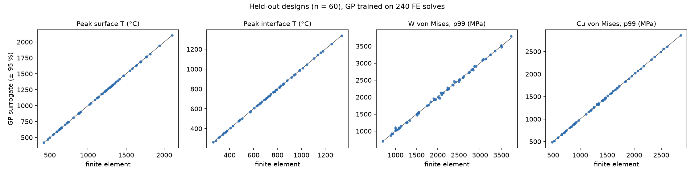
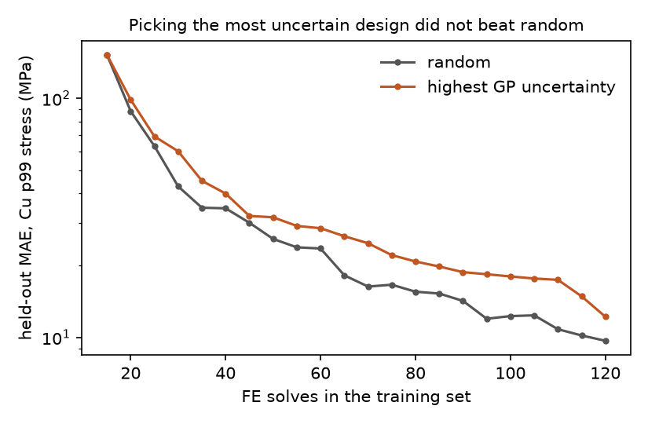

# Finite-element surrogates for a tungsten-on-copper tile, checked before trusted

A 2-D thermo-mechanical finite-element model of a water-cooled tungsten tile on a copper heat sink (the building block of a fusion divertor), 300 solves over a five-parameter design space, and two surrogate models of it: a Gaussian process and a small neural network. Every step has a check: the solver against an exact solution, the stress metric against mesh refinement, the surrogates against held-out FE results, and the uncertainty estimate against how often it actually contains the truth.

Everything is public and generic: textbook material constants, a parametric geometry, open-source tools (scikit-fem, gmsh, scikit-learn). No data from any institute.



## The model

`fe_model.py`: a 24 mm wide tile, tungsten armour on a copper heat sink with a circular cooling channel at mid-height.

- **Heat:** steady conduction, heat flux *q* on the top surface, convection *h* (*T* − 100 °C) on the channel wall, insulated elsewhere. P2 triangles.
- **Stress:** plane-strain linear thermo-elasticity from a stress-free state at 20 °C, bottom edge fixed vertically, one corner fixed horizontally.
- **Design space** (Latin hypercube, 300 points): *q* 5–20 MW/m², tungsten 2–8 mm, copper 8–14 mm, *h* 20–150 kW/m²K, channel radius 2–4 mm (with at least 1.5 mm of copper above and below).

## Checks on the solver

| Check | Result |
|---|---|
| Thermal solve vs the exact 1-D answer (channel replaced by a cooled bottom edge, three designs) | relative error ≤ 5 × 10⁻¹³ |
| Peak surface temperature, mesh 0.8 → 0.1 mm | 936.3 → 935.1 °C |
| Raw peak von Mises in W, same refinement | 1958 → 2545 MPa, still rising |
| 99th-percentile von Mises in W (area-weighted) | 1620.0 / 1619.1 / 1620.2 / 1618.8 MPa |

The raw stress maximum never converges: the corner where tungsten, copper and the free edge meet is a genuine singularity of linear elasticity, so its value is set by the mesh. A surrogate trained on it would learn the mesh, not the physics. The area-weighted 99th percentile is mesh-independent to 0.1 % and is what the surrogates predict.

**A bug the data found.** The first 300-solve run had one design at 912,060 MPa against a range of 695–5,049 MPa for the other 299. Its thermal solution was normal, so the mechanical solve was suspect. The cause: the horizontal corner constraint selected DOFs with a coordinate function, which in scikit-fem matches facets, not a single vertex, so it matched nothing. The rigid-body translation was never fixed in any solve, and the sparse solver returned garbage for one design. With the vertex pinned directly, that design gives 2,144 MPa and the other 299 are identical to before (a rigid translation produces no strain). The dataset here is the regenerated one.

## Surrogates on 60 held-out designs (trained on 240)

| Target | GP MAE | GP max error | GP 95 % interval covers truth | MLP MAE | 1-D formula MAE |
|---|---|---|---|---|---|
| Peak surface T | 0.95 °C (0.09 %) | 3.4 °C | 87 % | 29.6 °C | 85.0 °C (7.7 %) |
| Peak interface T | 1.8 °C (0.30 %) | 5.5 °C | 88 % | 21.9 °C | – |
| W von Mises, p99 | 20.8 MPa (1.2 %) | 94 MPa | 82 % | 70.9 MPa | – |
| Cu von Mises, p99 | 4.2 MPa (0.35 %) | 20 MPa | 92 % | 44.2 MPa | – |

- The GP is the right tool at this data size: it beats the MLP by 3–30× on every target.
- The 1-D conduction formula (what a hand calculation gives) is off by 85 °C on average, because the channel concentrates heat. That gap is what the 2-D model and its surrogate are for.
- **The GP's uncertainty is over-confident**: its nominal 95 % interval contains the FE value 82–92 % of the time, not 95 %. Using it to decide "no FE solve needed here" would need a calibration step first.

## Active learning did not help here



Starting from 15 random solves and adding 5 at a time, picking the designs where the GP is least certain gave a *worse* model than picking at random (Cu stress MAE 12.2 vs 9.7 MPa at 120 solves, mean of 3 seeds). Maximum-variance sampling chases the corners of the design box, where the GP is uncertain but held-out designs rarely are. On a smooth five-parameter response, a space-filling random sample is already close to optimal. Integrated-variance or error-weighted criteria would be the next thing to test, not something to assume.

## Limits

- Linear elastic, constant properties: the stresses (up to 5 GPa) are far above yield, so they are a smooth benchmark target, not predictions of real component stress. A real assessment needs temperature-dependent properties, copper plasticity and the fabrication (braze cool-down) history.
- 2-D plane strain, one geometry family, steady state.
- One random 240/60 split; the active-learning curve is a mean of three seeds.

## Run

```sh
pip install -r requirements.txt
python fe_model.py            # solver checks: 1-D exact solution, mesh convergence
python surrogate.py generate  # 300 FE solves -> data/fe_samples.csv (~3 min)
python surrogate.py evaluate  # -> results/evaluation.json
python surrogate.py active    # -> results/active_learning.json
python plots.py               # -> results/*.png
```

Author: Venkata Sai Pranav Regulagedda (M.Sc. Materials Science, KIT; thesis on tungsten–copper plasma-facing components at Max Planck IPP).
