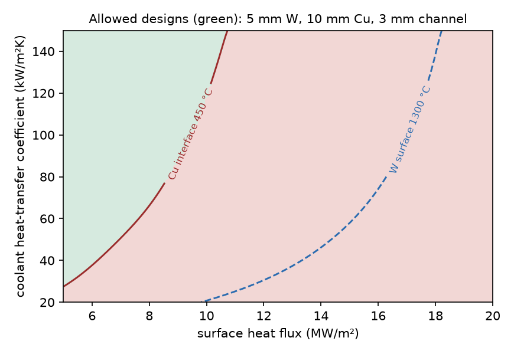
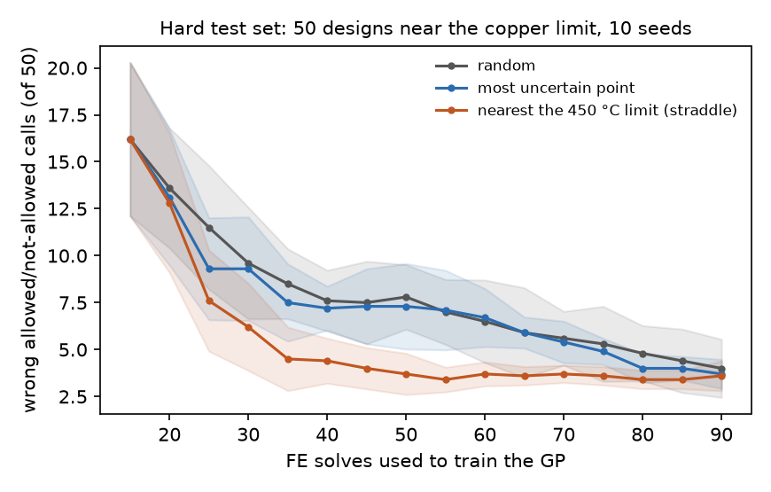

# Which tile designs are allowed? FE surrogates for a tungsten-on-copper fusion tile

A 2-D finite-element model of a water-cooled tungsten tile on a copper heat sink (a simplified divertor element), 300 solves across a five-parameter design space, and Gaussian-process surrogates used for the question an engineer actually asks: **does this design stay inside the material limits?** Each step has a check: the solver against an exact solution and mesh refinement, the surrogates against held-out FE results, the classification against a test set built from designs right at the limit.

Everything is public and generic: textbook constants, a parametric geometry, open-source tools (scikit-fem, gmsh, scikit-learn). No data from any institute.



**The engineering result.** For this flat tile (5 mm W, 10 mm Cu, one 3 mm cooling channel) the binding limit is the copper, not the tungsten: the W/Cu interface passes 450 °C, where CuCrZr starts to lose its strength, at about 8.5–11 MW/m² for coolant heat-transfer coefficients of 80–150 kW/m²K, well before the tungsten surface reaches recrystallisation. A long copper heat path is costly, which is one reason ITER-type divertors use monoblocks with only a thin copper layer between armour and coolant tube. In the full design space only 21 % of the 300 designs respect both limits.

## The model

`fe_model.py`: a 24 mm wide tile, tungsten armour on a copper heat sink with a circular cooling channel at mid-height of the copper.

- **Heat:** steady conduction, heat flux *q* on top, convection *h* (*T* − 100 °C) on the channel wall, insulated elsewhere. P2 triangles. Conductivities are held constant (W 130, Cu 380 W/m·K), which makes hot designs somewhat optimistic for tungsten.
- **Design space** (Latin hypercube, 300 points): *q* 5–20 MW/m², tungsten 2–8 mm, copper 8–14 mm, *h* 20–150 kW/m²K, channel radius 2–4 mm.
- **Screening limits:** Cu interface ≤ 450 °C, W surface ≤ 1300 °C (`feasibility.py`; change them there). They are screening values, not design-code allowables.

| Solver check | Result |
|---|---|
| Thermal solve vs the exact 1-D answer (three designs) | relative error ≤ 5 × 10⁻¹³ |
| Peak surface temperature, mesh 0.8 → 0.1 mm | 936.3 → 935.1 °C |

## Surrogates on 60 random held-out designs (trained on 240)

| Target | GP mean abs. error | GP max error | MLP, tuned by 5-fold CV | 1-D hand formula |
|---|---|---|---|---|
| Peak surface T | 0.95 °C | 3.4 °C | 14.2 °C | 85.0 °C |
| Peak interface T | 1.8 °C | 5.5 °C | 13.9 °C | – |

At this data size the GP is the right tool; a cross-validated neural network (grid over width, depth, regularisation and learning rate) is 7–15× worse. The 1-D formula that a hand calculation would use is off by 85 °C on average because the channel concentrates the heat, which is the reason to run the 2-D model at all. The GP's nominal 95 % intervals contain the FE value only 87–88 % of the time, so its uncertainty should be calibrated before it is used to skip simulations.

## How many simulations does it take to know which designs are allowed?

On the random test set all three methods reach zero or near-zero misclassifications within 30–55 solves, but that set has only 3 designs within 25 °C of the copper limit, so it mostly tests easy cases. The honest test is a **hard set**: 50 new FE solves of designs placed at the limit (12 within ±10 °C of 450 °C). Starting from 15 random solves and adding 5 at a time (picked one by one, each pick added at its predicted value so a batch spreads out), averaged over 10 seeds:



| FE solves | random | most uncertain point | nearest the limit (straddle rule) |
|---|---|---|---|
| 25 | 11.5 ± 3.3 wrong | 9.3 ± 2.7 | **7.6 ± 2.7** |
| 35 | 8.5 ± 1.9 | 7.5 ± 2.1 | **4.5 ± 1.7** |
| 50 | 7.8 ± 1.7 | 7.3 ± 2.3 | **3.7 ± 1.1** |
| 90 | 4.0 ± 1.6 | 3.7 ± 0.8 | 3.6 ± 0.8 |

- Sampling where the GP is most likely to be on the wrong side of the limit reaches, with about 35–45 solves, the accuracy random sampling reaches with 90.
- Sampling the most uncertain point is barely better than random: uncertainty is largest at the corners of the design box, not at the limit.
- About 3–4 designs stay wrong at 90 solves whatever the method. They sit within a few degrees of 450 °C, inside the GP's own error on this set (median 1.3 °C, max 8.5 °C); with all 240 training solves one remains wrong, at 451.7 °C. A real workflow would send designs that close to the limit to a full FE solve.
- The boundary-focused GP is a worse general model (interface MAE 8.5 vs 4.4 °C for random at 90 solves on the random test set). It learned the question, not the whole field.

## What the stresses are, and are not

`fe_model.py` also solves plane-strain linear thermo-elasticity from a stress-free state at 20 °C and reports an area-weighted 99th-percentile von Mises stress (the raw maximum sits on a bimaterial-corner singularity and grows with mesh refinement; the p99 is mesh-independent to 0.1 %). These are **thermal-mismatch indicators, not design stresses**: at these temperatures the copper is far beyond yield, and a real assessment needs copper plasticity and the fabrication history (the cool-down after joining loads the interface more than operation does). The GP predicts the indicator within 0.35–1.2 %, but I would not size a component on it.

**A bug the stresses found.** In the first run one design came out at 912,060 MPa against 695–5,049 MPa for the rest, with a normal temperature field. The horizontal rigid-body constraint selected DOFs with a coordinate function, which in scikit-fem matches facets, not a single vertex, so it matched nothing in any solve; the solver returned garbage for one design. With the corner vertex pinned directly that design gives 2,144 MPa and the other 299 are unchanged (a rigid translation produces no strain). The dataset here is the regenerated one.

## Limits

- 2-D, steady state, constant properties, one geometry family; no plasticity in the stress indicator.
- One 240/60 split for the regression table; the active-learning curves are means over 10 seeds on a 50-design hard set.
- Screening limits are fixed numbers; real allowables depend on the alloy condition, irradiation and time at temperature.

## Run

```sh
pip install -r requirements.txt
python fe_model.py                 # solver checks: exact 1-D solution, mesh convergence
python surrogate.py generate       # 300 FE solves -> data/fe_samples.csv (~3 min)
python surrogate.py evaluate       # GP vs untuned MLP vs 1-D formula -> results/evaluation.json
python feasibility.py mlp          # cross-validated MLP -> results/mlp_tuned.json
python feasibility.py classify     # held-out feasibility -> results/feasibility.json
python feasibility.py hard         # 50 FE solves at the limit -> data/boundary_test.csv
python feasibility.py active_hard  # sampling strategies on the hard set -> results/active_boundary_hard.json
python feasibility.py map          # results/feasibility_map.png
python plots.py                    # results/parity.png, results/active_boundary_hard.png
```

Author: Venkata Sai Pranav Regulagedda (M.Sc. Materials Science, KIT; thesis on tungsten–copper plasma-facing components at Max Planck IPP).
